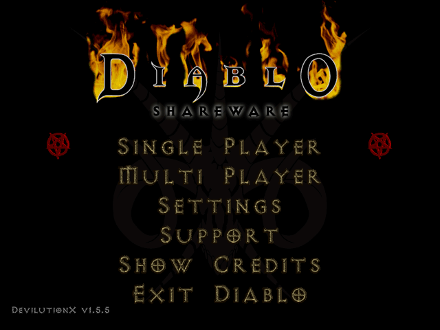
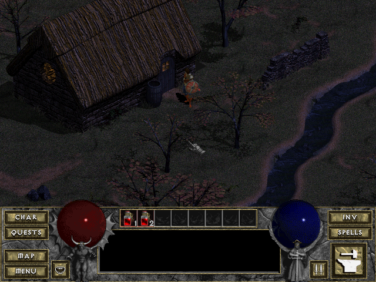
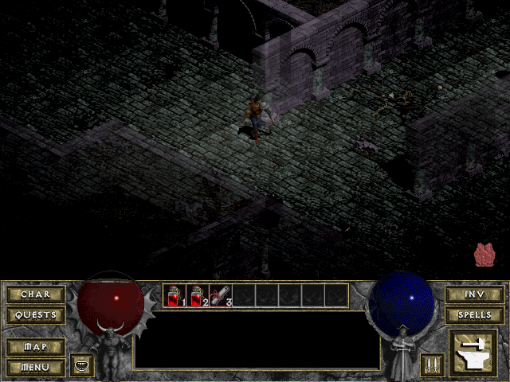
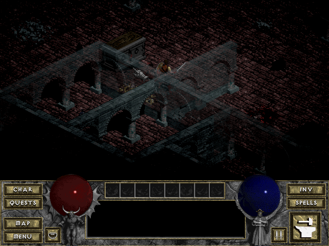

# pico-lutionX

A port of [DevilutionX](https://github.com/diasurgical/devilutionX), the open-source
engine for Blizzard's Diablo, to boards built around the Raspberry Pi RP2350
microcontroller: the Adafruit Fruit Jam, and a Pimoroni Pico Plus 2 with the Adafruit DVI
and microSD breakouts (see [Boards](#boards)). The picture goes out over HDMI at 640×480,
sound over HDMI or a headphone output, and the game is played with a USB keyboard and
mouse or a gamepad. The game data is read from an SD card: the shareware data of Diablo
(`spawn.mpq`) or the data of the full game (`DIABDAT.MPQ`).

> [!WARNING]
> **This is an early development version.** It has run on one board so far, the Pico
> Plus 2 board (HW_CONFIG 2). With the Zoom setting the game runs at its normal speed;
> without it, it runs somewhat slower than intended (see [Status](#status)). Reports
> from the UART console are welcome.

## Screenshots

| | |
|---|---|
|  |  |
| Main menu | Town |
|  |  |
| Cathedral, level 1 | Cathedral, level 2 |

The screenshots were rendered on a PC by the port's test program, which runs the same
game code with the board's memory limits, its flash asset cache and its 8-bit palette
picture.

## Status

Verified on a Pimoroni Pico Plus 2 with the Adafruit DVI and microSD breakouts
(HW_CONFIG 2), with the shareware data:

- The picture over HDMI, music and sound.
- The main menu, the town and the first level of the cathedral, including fighting.
- Saving a game and loading it again.
- A NES controller on a controller port.
- The game's graphics and sounds are copied to flash and used from there after a
  restart.

Frame rates on the first level of the cathedral:

| Setting | Frames per second |
|---|---|
| Zoom on (Settings, Graphics, Zoom) | 27 to 32 |
| Zoom off | 14 to 19 |

Diablo's game logic advances in 20 steps per second and DevilutionX takes at most one step
per frame, so below 20 frames per second the game runs correspondingly slower than
intended. Zoom shows the dungeon at twice the size, and therefore a smaller part of it,
which halves the work of drawing it. It is on by default on these boards and can be
switched off in the settings. The main menu runs at about 25 frames per second.

Verified in the test program on a PC (`hosttest/`), with the board's 8 MB of PSRAM:

- The main menu, the town and the cathedral levels of the shareware data load and play.
- Upstream's reference demo replays with the same outcome as on a PC
  (`WarriorLevel1to2`).
- Music and sound effects play.
- Assets are cached in flash and used from there, also after a restart.
- With the full game's data, a new hero can enter each of the 16 dungeon levels, both with
  an empty flash cache and with the cache filled by the levels visited before.

Not yet verified on a board:

- the Fruit Jam, and its headphone jack;
- USB keyboards, mice and gamepads, SNES controllers and the Wii extension port;
- the second level of the cathedral;
- the full game (`DIABDAT.MPQ`).

With the full game, the first visit to a level takes longer than later ones, because its
graphics and sounds are written to flash. Its sound effects are stored in flash as 4-bit
ADPCM, at half the size of the original 8-bit sound; a few of them sound slightly harsher
than on a PC. Network play and Hellfire are not supported.

## Boards

| Board | HW_CONFIG | Firmware file |
|---|---|---|
| Adafruit Fruit Jam | 8 | `pico-lutionX_fruitjam.uf2` |
| Pimoroni Pico Plus 2 with the [Adafruit DVI Breakout](https://www.adafruit.com/product/4984) and [Adafruit MicroSD breakout](https://www.adafruit.com/product/254), on a breadboard or the PicoNES PCB | 2 | `pico-lutionX_adafruitdvisd.uf2` |

Both boards need an RP2350 with 8 MB of PSRAM and 16 MB of flash. On the Pico Plus 2
board, USB devices are connected through a USB-A socket wired to GPIO 20 (D+) and 21
(D−), as for pico-quake2; NES or SNES controllers can be connected to the controller
ports of the PicoNES PCB. On the Fruit Jam, a Wii Classic Controller (or a compatible
pad) can be connected to its Wii extension port.

## What you need

- One of the boards above, an HDMI display and a microSD card (FAT32 or exFAT)
- The game data: `spawn.mpq` (the shareware data) or `DIABDAT.MPQ` (from the Diablo CD
  or a digital copy)
- A USB keyboard and mouse, or a USB gamepad; with several devices on one USB port, a
  USB hub
- Optionally, headphones (Fruit Jam) or a PCM5100A DAC (Pico Plus 2 board)

## Installing

1. Download the firmware for your board and `pico-lutionX_sdcard.zip` from the
   [releases page](https://github.com/PicoPlus-devel/pico-lutionX/releases).
2. Unpack `pico-lutionX_sdcard.zip` to the root of the SD card. This creates
   `roms/devilutionx` with DevilutionX's own assets (fonts, interface and level data).
3. Copy `spawn.mpq` or `DIABDAT.MPQ` into `roms/devilutionx`.
4. Hold the BOOTSEL button while connecting the board to a computer and copy the
   firmware (`.uf2`) to the drive that appears.
5. Insert the SD card and restart the board.

With pico-bootLoader, copy the bootloader build of the firmware to `/emu/<HW_CONFIG>/`
on the bootloader's SD card instead of step 4; the game data stays in
`roms/devilutionx`.

### The first start

The board copies the game's graphics and sounds into its flash memory the first time
they are needed, and uses them from there afterwards, also after a restart. The first
time the main menu, a game and each new area load therefore take noticeably longer
(about 10 to 20 seconds); the board LED blinks while it writes. A different `.mpq` file
makes the board discard the copies and start again.

## Controls

The controls are those of DevilutionX.

### Keyboard and mouse

The mouse works as in Diablo: the left button walks, attacks and picks up, the right
button casts the selected spell. The keyboard shortcuts are those of the original game,
for example `I` for the inventory, `C` for the character sheet, `B` for the spell book,
`Tab` for the map, `1`–`8` for the belt and `F1` for help. They can be changed in the
settings of the main menu.

### Gamepad

USB gamepads (Xbox, PlayStation, Switch and generic USB pads), NES/SNES controllers and
the Wii Classic Controller are presented to the game as one gamepad, with the buttons
named by position:

| Button | Position (Xbox / PlayStation / SNES) |
|---|---|
| A | bottom (A / cross / B) |
| B | right (B / circle / A) |
| X | left (X / square / Y) |
| Y | top (Y / triangle / X) |
| Left and right shoulder | LB, RB / L1, R1 / L, R |
| Left and right trigger | LT, RT / L2, R2 |
| Back, Start | View or Select, Menu or Start |

What each button does is DevilutionX's gamepad layout, which can be changed in the
settings. A new hero can be created with a gamepad only: a name is filled in.

## Saving

Games are saved in `roms/devilutionx` as DevilutionX saves them on a PC (`spawn_N.sv`,
`single_N.sv`), together with `diablo.ini`. The files can be copied to and from
DevilutionX 1.5.5 on a PC.

## When something goes wrong

Errors that stop the game are shown on the screen. The board also writes a log to its
UART (GPIO 0 on the Pico Plus 2, GPIO 44 on the Fruit Jam, 115200 baud) with the start-up,
the loading of the game data and any errors. A firmware built with the option
`DX_PERF_LOG` adds a status line every 5 seconds with the frame rate, the memory use and
where the time of a frame is spent (see [TECHNICAL.md](TECHNICAL.md)); writing it
interrupts the sound briefly.

**Pico Plus 2: the board starts in BOOTSEL mode after pressing its reset button.** On this
board, a reset that happens while the PSRAM is being read can leave the PSRAM connected to
the bus, which stops the RP2350 from reading the firmware. Pressing reset again does not
help; disconnect the power and connect it again. To restart the game, use Quit Game in the
game menu or Exit Diablo in the main menu instead of the reset button; both restart the
board. The cause lies in the board's wiring (see
[TECHNICAL.md](TECHNICAL.md), "Reset and BOOTSEL on the Pico Plus 2").

## Building from source

```sh
export PICO_SDK_PATH=/path/to/pico-sdk          # version 2.2.0
export PICO_PIO_USB_PATH=/path/to/Pico-PIO-USB
./fruitjam-build.sh                             # or ./adafruitdvisd-build.sh
./fruitjam-build-forbootloader.sh               # pico-bootLoader variant
./buildAll.sh                                   # every release file into releases/
```

The test program for a PC is built with `hosttest/build.sh`; see
[TECHNICAL.md](TECHNICAL.md) for how the port works and how to test it.

## Credits

- DevilutionX by the [Diasurgical](https://github.com/diasurgical) contributors.
- Diablo © Blizzard Entertainment. This project is not affiliated with or endorsed by
  Blizzard Entertainment. Diablo is a trademark of Blizzard Entertainment.
- The platform layer follows pico-quake2 and pico-duke3D; the drivers come from
  [pico_shared](https://github.com/fhoedemakers/pico_shared).
- Libraries: libmpq, zlib, PKWARE DCL explode/implode (StormLib), {fmt}, SimpleIni,
  dr_mp3 (David Reid), TLSF (Matthew Conte), TinyUSB, Pico-PIO-USB, FatFs, pico_hdmi.

### Use of AI

The port was written with the help of Claude Code.

## Licence

DevilutionX is distributed under the Sustainable Use License 1.0
([3rdparty/devilutionX/LICENSE.md](3rdparty/devilutionX/LICENSE.md)): it may be shared
free of charge for non-commercial purposes only. The libraries in `3rdparty/` keep their
own licences (see the `UPSTREAM.md` files there). The licence of the port's own code will
be stated here before the first release. The game data is not part of this project.
