# pico-lutionX

A port of [DevilutionX](https://github.com/diasurgical/devilutionX), the open-source
engine for Blizzard's Diablo, to boards built around the Raspberry Pi RP2350
microcontroller: the Adafruit Fruit Jam, and a Pimoroni Pico Plus 2 with the Adafruit DVI
and microSD breakouts. The picture goes out over HDMI at 640×480, sound over HDMI or a
headphone output, and the game is played with a USB keyboard and mouse or a gamepad. The
game data is read from an SD card: the shareware data of Diablo ([spawn.mpq](https://github.com/diasurgical/devilutionx-assets/releases/latest/download/spawn.mpq)) or the data
of the full game (`DIABDAT.MPQ`).

> [!WARNING]
> **This is an early development version.** It has been tested on both supported boards,
> the Pico Plus 2 board (HW_CONFIG 2) and the Fruit Jam (HW_CONFIG 8). With the Zoom
> setting the game runs at its normal speed; without it, it runs somewhat slower than
> intended (see [Zoom and frame rate](#zoom-and-frame-rate)). See [Status](#status) for
> what has been tested. Reports from the UART console are welcome.

## Features

**Game**
- Diablo in single player, with the shareware data (`spawn.mpq`) or the full game
  (`DIABDAT.MPQ`). Network play and Hellfire are not supported.
- Saved games are compatible with DevilutionX 1.5.5 on a PC. See [Saving](#saving).

**Picture and sound**
- 640×480 over HDMI. The [Zoom](#zoom-and-frame-rate) setting, on by default, shows the
  dungeon at twice the size and keeps the game at its normal speed.
- Music and sound effects over HDMI; on the Fruit Jam also through the headphone jack, on
  the Pico Plus 2 board also through an optional PCM5100A DAC.

**Controls**
- A USB keyboard and mouse, USB gamepads (Xbox and other XInput pads, DualShock 4,
  DualSense, Switch and generic USB pads), NES and SNES controllers and the original SNES
  Mouse on the [PicoNES PCB](#picones-pcb), and the Wii Classic Controller on the Fruit
  Jam. Every button of the Xbox, PlayStation, SNES and NES controllers has a function. See
  [Controls](#controls).

**Other**
- The game's graphics and sounds are copied to the board's flash memory the first time
  they are needed, so later loads are faster. See [The first start](#the-first-start).
- Runs standalone, or under [pico-bootLoader](#with-pico-bootloader).
- [Test programs for a PC](#test-programs-for-a-pc) that run the same game code with the
  board's memory limits, for developers.

See [Known limitations](#known-limitations) for what is not supported.

## Screenshots

|   | Zoom on (default) | Zoom off |
|---|---|---|
| **Town** | 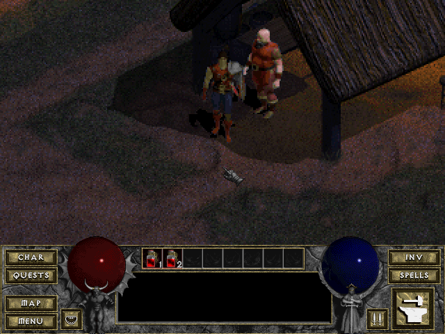 | 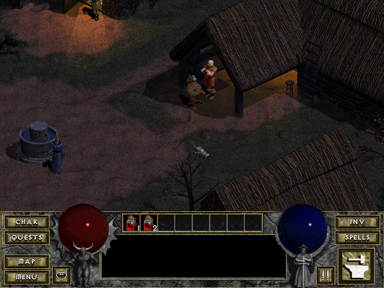 |
| **Cathedral**<br>level 2 | 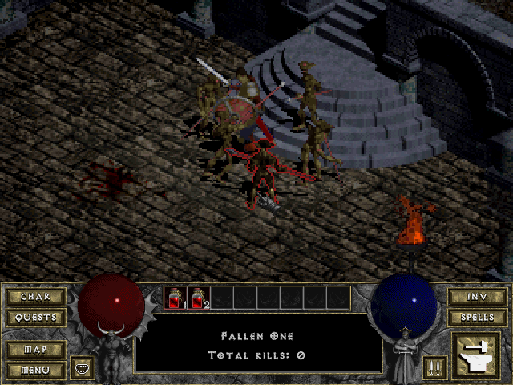 | 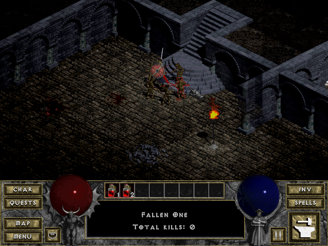 |
| **Catacombs**<br>level 6 | 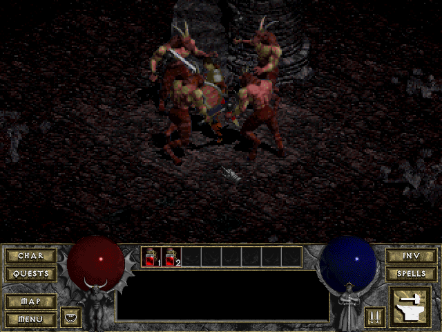 | 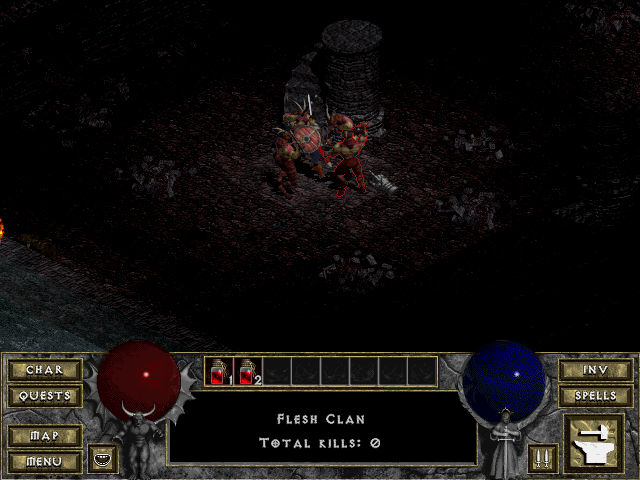 |
| **Caves**<br>level 10 | 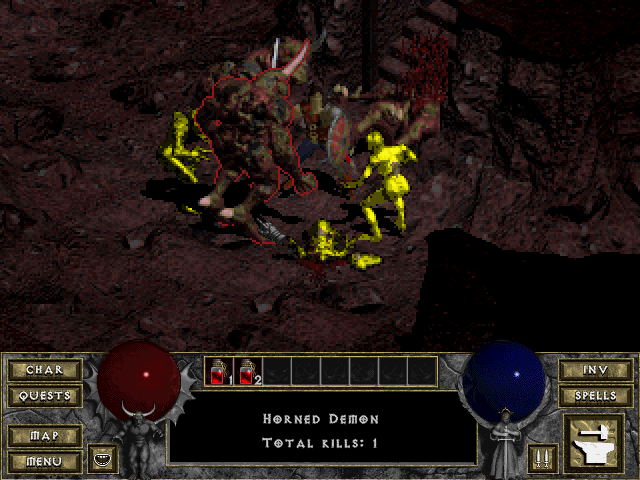 | 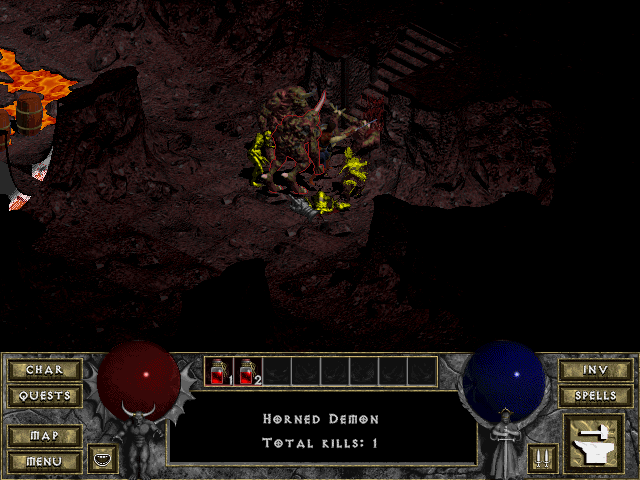 |
| **Hell**<br>level 15 | 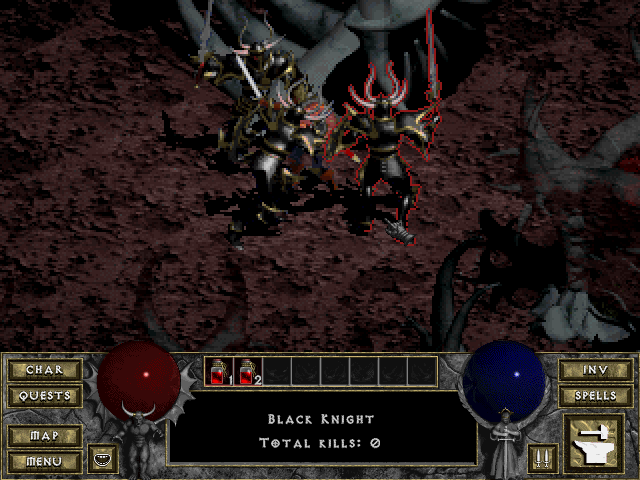 | 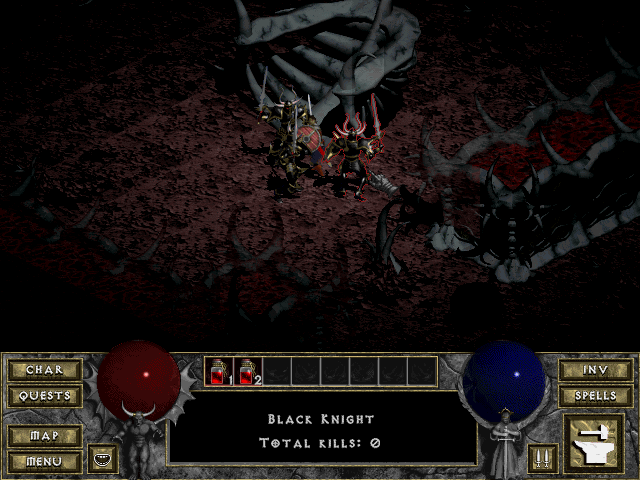 |
| **Hell**<br>level 16 | 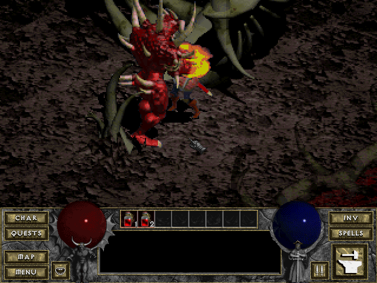 | 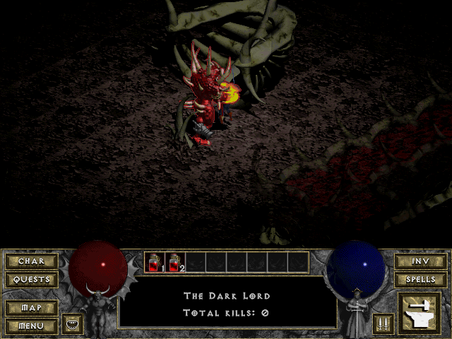 |

| Main menu | Character sheet and inventory |
|---|---|
| 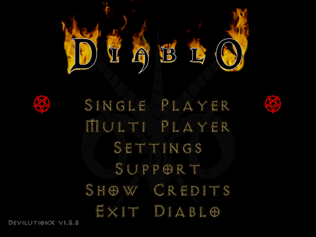 | 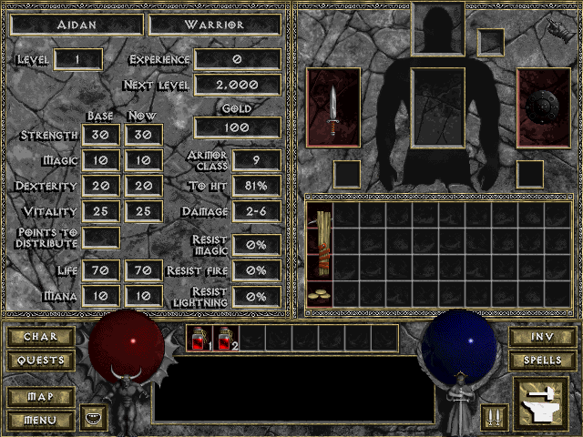 |

The screenshots show the full game. They were rendered on a PC by the port's test
program, which runs the same game code with the board's memory limits and its flash asset
cache, in the colours of the board's HDMI output. In the dungeon pictures a hero from the
[test saves](testsaves/README.md) fights monsters that were placed next to it with
DevilutionX's debug commands.

## Status

Verified on a Pimoroni Pico Plus 2 with the Adafruit DVI and microSD breakouts
(HW_CONFIG 2), with the shareware data:

- The picture over HDMI, music and sound.
- The main menu, the town and the first level of the cathedral, including fighting.
- Saving a game and loading it again.
- A NES controller on a controller port.
- A USB keyboard, a USB mouse and a DualShock 4 on the USB-C port, and an original SNES
  Mouse on a controller port.
- The game's graphics and sounds are copied to flash and used from there after a
  restart.

Verified on the Adafruit Fruit Jam (HW_CONFIG 8):

- Playing the game, with Zoom on and off.
- The picture over HDMI, also on a 55-inch TV without tearing.
- Sound through the headphone jack.
- A USB keyboard, a USB mouse and a DualShock 4, found at every start.

Verified in the test program on a PC (`hosttest/`), with the board's 8 MB of PSRAM:

- The main menu, the town and the cathedral levels of the shareware data load and play.
- Upstream's reference demo replays with the same outcome as on a PC
  (`WarriorLevel1to2`).
- Music and sound effects play.
- Assets are cached in flash and used from there, also after a restart.
- With the full game's data, a new hero can enter each of the 16 dungeon levels, both with
  an empty flash cache and with the cache filled by the levels visited before.

Not yet verified on a board:

- the Fruit Jam's Wii extension port;
- USB gamepads other than the DualShock 4, and SNES controllers;
- the second level of the cathedral;
- the full game (`DIABDAT.MPQ`) beyond loading it: it loads on the board, but has not
  been tested completely.

## Getting started

### What you need

- One of the [supported boards](#supported-boards), an HDMI display and a microSD card
  (FAT32 or exFAT)
- The game data: [spawn.mpq](https://github.com/diasurgical/devilutionx-assets/releases/latest/download/spawn.mpq) (the shareware data) or `DIABDAT.MPQ` (from the Diablo CD
  or a digital copy)
- A USB keyboard and mouse, or a USB gamepad; with several devices on one USB port, a
  USB hub. On the Pico Plus 2 board, NES or SNES controllers and a SNES Mouse can be used
  as well.
- Optionally, headphones (Fruit Jam) or a PCM5100A DAC (Pico Plus 2 board)

### Installing

1. Download the firmware for your board and `pico-lutionX_sdcard.zip` from the
   [releases page](https://github.com/PicoPlus-devel/pico-lutionX/releases).
2. Unpack `pico-lutionX_sdcard.zip` to the root of the SD card. This creates
   `roms/devilutionx` with DevilutionX's own assets (fonts, interface and level data).
3. Copy [spawn.mpq](https://github.com/diasurgical/devilutionx-assets/releases/latest/download/spawn.mpq) or `DIABDAT.MPQ` into `roms/devilutionx`.
4. Hold the BOOTSEL button while connecting the board to a computer and copy the
   firmware (`.uf2`) to the drive that appears.
5. Insert the SD card and restart the board.

### The first start

The board copies the game's graphics and sounds into its flash memory the first time
they are needed, and uses them from there afterwards, also after a restart. The first
time a game and each new area load therefore take noticeably longer (about 10 to 20
seconds); the board LED blinks while it writes. The main menu's pictures are not copied;
they are read from the SD card each time. When the flash memory is full, the copies used
least recently make room for new ones, so with the full game an area that has not been
visited for a while can take longer to load again. A different `.mpq` file makes the
board discard the copies and start again.

### Flash memory wear

The copies are kept in the upper 13 MB of the board's 16 MB flash memory. The game never
writes to the part that holds the firmware or pico-bootLoader. Flash memory wears with
every erase; the chips on these boards are rated for at least 100,000 erase cycles per
4 KB sector. Measured in the test program, per trip from the town to a dungeon level:

- With the shareware data, once the copies have been made, almost nothing is written
  (less than 0.1 MB per trip).
- With the full game, the 13 MB cannot hold all of the game's graphics, so moving between
  parts of the dungeon replaces copies: 2 to 5 MB per trip, and the most-erased sector is
  erased up to about twice per trip. At that rate the rated endurance is reached after
  roughly 50,000 such trips.

The flash writing is therefore no practical risk to the board. Copies that are damaged,
or overwritten by another program that uses the same part of the flash (for example
under pico-bootLoader), are detected by a checksum and copied again.

### With pico-bootLoader

[pico-bootLoader](https://github.com/PicoPlus-devel/pico-bootLoader) lists the game as
*Diablo* in its Ports category, on the Fruit Jam (HW_CONFIG 8) and on the Pico Plus 2
board (HW_CONFIG 2). Its SD-card archive contains the bootloader build of the firmware,
so step 4 is not needed. Its `updateAll` program installs DevilutionX's assets and the
shareware data (`spawn.mpq`) in `roms/devilutionx`, in place of steps 1 to 3; for the
full game, copy `DIABDAT.MPQ` into the same folder.

Quit Game or Exit Diablo returns to the boot menu. On the Fruit Jam the reset button
does so as well; on the Pico Plus 2 it can start the board in BOOTSEL mode, as without
the bootloader (see [When something goes wrong](#when-something-goes-wrong)).

To install a build by hand, copy it to `/emu/<HW_CONFIG>/` on the bootloader's SD card.
The bootloader builds are made with `./fruitjam-build-forbootloader.sh` and
`./adafruitdvisd-build-forbootloader.sh` (see [Building from source](#building-from-source)).

## Supported boards

| Board | HW_CONFIG | Build command | Release binary |
|---|---|---|---|
| Adafruit [Fruit Jam](https://www.adafruit.com/product/6200) | 8 | `./fruitjam-build.sh` | `pico-lutionX_fruitjam.uf2` |
| [Pimoroni Pico Plus 2](https://shop.pimoroni.com/products/pimoroni-pico-plus-2) with the [Adafruit DVI breakout](https://www.adafruit.com/product/4984) and [Adafruit microSD breakout](https://www.adafruit.com/product/254), on a breadboard or the [PicoNES PCB](#picones-pcb) | 2 | `./adafruitdvisd-build.sh` | `pico-lutionX_adafruitdvisd.uf2` |

Both boards need an RP2350 with 8 MB of PSRAM and 16 MB of flash. The second board is
the configuration the pico_shared emulators call HW_CONFIG 2. It must use a Pimoroni Pico
Plus 2, or another RP2350B module with 8 MB of PSRAM on GPIO 47 and 16 MB of flash; a
Raspberry Pi Pico 2 has no PSRAM and does not work.

The hardware is the same as for the NES emulator, so the setup instructions are in the
pico-infonesPlus readme:

| Board | Setup instructions |
|---|---|
| Adafruit Fruit Jam | [Fruit Jam](https://github.com/PicoPlus-devel/pico-infonesPlus/blob/main/README.md#adafruit-fruit-jam) |
| Pimoroni Pico Plus 2 on a breadboard with Adafruit breakouts, or on the PicoNES PCB | [Adafruit hardware and breadboard](https://github.com/PicoPlus-devel/pico-infonesPlus/blob/main/README.md#raspberry-pi-pico-or-pico-2-setup-with-adafruit-hardware-and-breadboard), [PicoNES PCB](#picones-pcb) |

The Pico Plus 2 board is wired as follows:

| Function | GPIO |
|---|---|
| Adafruit DVI breakout | D0+ 12, CK+ 14, D2+ 16, D1+ 18 (and the pins next to them) |
| Adafruit microSD breakout | SCK 2, MOSI 3, MISO 4, CS 5 |
| NES/SNES controller port 1 | CLK 6, DATA 7, LATCH 8 |
| NES/SNES controller port 2 | CLK 9, DATA 10, LATCH 11 |
| PCM5100A I2S DAC (optional) | DATA 26, BCK 27, LRCK 28 |
| Serial console (optional) | TX 0, RX 1 |

On the Pico Plus 2 board, USB devices are connected to the USB-C port of the Pico Plus 2
through a USB OTG adapter or Y-cable, which also has to supply the board's power; NES or
SNES controllers and an original SNES Mouse can be connected to the controller ports of
the PicoNES PCB. On the Fruit Jam, USB devices go into its USB ports, and a Wii Classic
Controller (or a compatible pad) can be connected to its Wii extension port.

## PicoNES PCB

The Pico Plus 2 board can be built on the PicoNES PCB by John Edgar Park instead of a
breadboard, which turns it into a small console with two controller ports and a case.
The PCB comes in two versions, which differ only in the controller ports: **v2.6** with
NES controller ports and **v2.8** with SNES controller ports. Parts lists, ordering
instructions, assembly notes, the pin assignment and the 3D-printed case are described in
the [PCB README](https://github.com/PicoPlus-devel/pico_shared/blob/main/PCB/README.md).

| Design | Picture | Controller ports | Designed by |
|---|---|---|---|
| PicoNES v2.6 |  | 2 × NES | [John Edgar Park](https://twitter.com/johnedgarpark) |
| PicoNES v2.8 |  | 2 × SNES | [John Edgar Park](https://twitter.com/johnedgarpark) |

> [!NOTE]
> The PicoNES v2.6 and v2.8 are shown with a Pimoroni Pico Plus 2. The game needs its
> PSRAM and 16 MB of flash, so no other board can be fitted. The other designs in the PCB
> README, the PicoNES Mini and PicoNES Micro, carry boards without PSRAM and cannot run
> the game.

> [!NOTE]
> Sellers on AliExpress have copied the PicoNES design and sell ready-made boards. For
> questions about those, contact the seller.

- **Mounting.** The Pimoroni Pico Plus 2 must be mounted on male pin headers, because the
  SP/CE connector on its back prevents it from lying flat. Optional female socket headers,
  soldered into the PCB, let the board be plugged in and swapped without desoldering.
- **Controllers.** On v2.8, SNES controllers plug in directly; on v2.6, NES controllers
  do, and a SNES controller needs a
  [SNES-to-NES adapter cable](https://github.com/PicoPlus-devel/pico-snesPlus/blob/main/snestonescontroller.md),
  one per port. An original SNES Mouse can be used in either port in the same way. See
  [Gamepad](#gamepad) for the layout. A USB keyboard, mouse or gamepad goes on the Pico
  Plus 2's USB-C port through an OTG adapter or Y-cable (see
  [Supported boards](#supported-boards)).
- **Sound.** Over HDMI.
- **microSD breakout.** The PCB is laid out for the smaller
  [Adafruit Micro SD SPI or SDIO Card Breakout](https://www.adafruit.com/product/4682),
  which uses the same GPIO as the breakout in the wiring table above.
- **What to flash.** `pico-lutionX_adafruitdvisd.uf2`, the same file as for the
  breadboard.

The parts lists and assembly notes are in the PCB README:
[PicoNES v2.6](https://github.com/PicoPlus-devel/pico_shared/blob/main/PCB/README.md#picones-v26-nes-controller-ports)
and
[PicoNES v2.8](https://github.com/PicoPlus-devel/pico_shared/blob/main/PCB/README.md#picones-v28-snes-controller-ports).

| NES controller ports (v2.6) | SNES controller ports (v2.8) |
|---|---|
|  |  |

### 3D printed case

Gavin Knight ([DynaMight1124](https://github.com/DynaMight1124)) designed an NES-like case
for the v2.6 PCB: [thingiverse.com/thing:6689537](https://www.thingiverse.com/thing:6689537).
It does not fit the v2.8 PCB. Two top covers are available, one with a button that presses
the BOOTSEL button for firmware updates and one without. All parts are shown in the
[PCB README](https://github.com/PicoPlus-devel/pico_shared/blob/main/PCB/README.md#3d-printed-case).
For questions about the case, please contact the designer on the Thingiverse page.

> [!IMPORTANT]
> Download the **latest** top cover. The Pimoroni Pico Plus 2 is always mounted on headers
> here, and headers raise the board. Only the newest cover leaves room for the USB cable;
> the older ones assume a Pico soldered flat onto the PCB.

| Top cover | Base |
|---|---|
|  |  |

## Controls

The controls are those of DevilutionX.

### Keyboard and mouse

The mouse works as in Diablo: the left button walks, attacks and picks up, the right
button casts the selected spell. The keyboard shortcuts are those of the original game,
for example `I` for the inventory, `C` for the character sheet, `B` for the spell book,
`Tab` for the map, `1`–`8` for the belt and `F1` for help. They can be changed in the
settings of the main menu.

### SNES Mouse

On the Pico Plus 2 board, an original SNES Mouse can be used instead of, or together
with, a USB mouse. It plugs into either controller port (a port for NES controllers needs
a SNES-to-NES adapter cable), and a controller can be used in the other port at the same
time. Its two buttons are the left and right mouse buttons. The board sets the mouse to
its lowest sensitivity when it is connected. The cursor moves about 200 pixels per inch
when the mouse is moved slowly, for precise aiming, and up to about 800 when it is moved
fast.

### Gamepad

USB gamepads (Xbox and other XInput pads, DualShock 4, DualSense, Switch and generic USB
pads), NES and SNES controllers and the Wii Classic Controller are presented to the game
as one gamepad. Every button of the Xbox, PlayStation, SNES and NES controllers has a
function:

| Action | Xbox | PlayStation | SNES | NES |
|---|---|---|---|---|
| Walk | D-pad, left stick | D-pad, left stick | D-pad | D-pad |
| Attack, talk; take or place an item in the inventory | B | Circle | A | A |
| Open doors and chests, pick up items; use an item in the inventory | Y | Triangle | X | B |
| Cast the active spell | X | Square | Y | Select + A |
| Speedbook (choose the active spell); close the open panels | A | Cross | B | Select + B |
| Health potion | LB | L1 | L | Select + Up |
| Mana potion | RB | R1 | R | Select + Down |
| Character sheet | LT | L2 | Start + Left | Start + Left |
| Inventory | RT | R2 | Start + Right | Start + Right |
| Spellbook | Back + RT | Share + R2 | Start + B | Start + A |
| Quest log | Back + LT | Share + L2 | Start + Y | Start + B |
| Automap | Left stick click | L3 | Start + Down | Start + Down |
| Game menu | Back + Start, Guide | Share + Options, PS | Select + Start | Select + Start |
| Quick spells 1 to 4 | Back + X, Y, A, B | Share + Square, Triangle, Cross, Circle | Select + Y, X, B, A | |
| Move the cursor | Right stick, Back + D-pad | Right stick, Share + D-pad | Select + D-pad | |
| Left mouse button | Right stick click, Back + LB | R3, Share + L1 | Select + L | |
| Right mouse button | Back + right stick click, Back + RB | Share + R3, Share + R1 | Select + R | |

- Back is labelled View on newer Xbox controllers. On PlayStation controllers, Share
  (Create on the DualSense) and a click on the touchpad are Back, and Options is Start.
- Holding Start opens DevilutionX's gamepad menu on every controller. With it, Up opens
  the game menu, Down the automap, Left the character sheet and Right the inventory; the
  bottom face button opens the spellbook and the left face button the quest log. On a
  NES controller, A and B take the place of these two face buttons.
- A quick spell is assigned by opening the speedbook, pointing at a spell and pressing
  Back together with a face button.
- On a NES controller, Select only works together with another button.
- In the main menu, the bottom face button (NES: B) or Start confirms, the right face
  button (NES: A) goes back.

The layout is DevilutionX's own and can be changed in the settings (Padmapping). The
combinations with Select on a NES controller stand for the SNES buttons in the same row
of the table and follow such changes. A new hero can be created with a gamepad only: a
name is filled in.

## Zoom and frame rate

Frame rates on the first level of the cathedral, on the Pico Plus 2 board:

| Setting | Frames per second |
|---|---|
| Zoom on (Settings, Graphics, Zoom) | 27 to 32 |
| Zoom off | 14 to 19 |

On the Fruit Jam, a first measurement during play gave about 29 frames per second with
Zoom on and about 21 with Zoom off.

Diablo's game logic advances in 20 steps per second and DevilutionX takes at most one step
per frame, so below 20 frames per second the game runs correspondingly slower than
intended. Zoom shows the dungeon at twice the size, and therefore a smaller part of it,
which halves the work of drawing it. It is on by default on these boards and can be
switched off in the settings. The main menu runs at about 25 frames per second. The
[screenshots](#screenshots) show both settings.

## Saving

Games are saved in `roms/devilutionx` as DevilutionX saves them on a PC (`spawn_N.sv`,
`single_N.sv`), together with `diablo.ini`. The files can be copied to and from
DevilutionX 1.5.5 on a PC.

Each save file holds one hero. A saved game is chosen in the main menu: Single Player
lists the heroes by name; select one and choose Load Game. In the game, Load Game in the
game menu only reloads the current hero; to change hero, choose Quit Game, which restarts
the board, and select another hero.

For testing, [testsaves/](testsaves/) holds one saved game per dungeon level (heroes
`Level01` to `Level16`), which can be copied to `roms/devilutionx` to start directly on any
level.

## Known limitations

- **Early development version.** Several features and controllers have not been tested
  on a board yet; see [Status](#status).
- **Frame rate.** Below 20 frames per second the game runs slower than intended. With Zoom
  off this is the case on the Pico Plus 2 board; see
  [Zoom and frame rate](#zoom-and-frame-rate).
- **Slow first loads.** The first time a game and each new area load take about 10 to 20
  seconds, while the graphics and sounds are copied to flash. With the full game, an area
  that has not been visited for a while can take longer to load again. See
  [The first start](#the-first-start).
- **Sound effects of the full game.** They are stored in flash as 4-bit ADPCM, at half the
  size of the original 8-bit sound; a few of them sound slightly harsher than on a PC.
- **Level 16 of the full game can run out of memory** after long play. See
  [When something goes wrong](#when-something-goes-wrong).
- **The reset button of the Pico Plus 2** starts the board in BOOTSEL mode. See
  [When something goes wrong](#when-something-goes-wrong).
- **Single player only.** Network play and Hellfire are not supported.
- **Overclocked.** The RP2350 runs at 384 MHz, more than twice its rated 150 MHz, with its
  core voltage at 1.50 V, above the 1.30 V limit of the chip's regulator. Both are outside
  the chip's specification. This has been reliable on the test boards so far.

## When something goes wrong

Errors that stop the game are shown on the screen. The board also writes a log to its
UART (GPIO 0 on the Pico Plus 2, GPIO 44 on the Fruit Jam, 115200 baud) with the start-up,
the loading of the game data and any errors. A firmware built with the option
`DX_PERF_LOG` adds a status line every 5 seconds with the frame rate, the memory use and
where the time of a frame is spent (see [TECHNICAL.md](TECHNICAL.md)); writing it
interrupts the sound briefly.

**Pico Plus 2: the board starts in BOOTSEL mode after pressing its reset button.** On this
board, a reset that happens while the PSRAM is being read can leave the PSRAM connected to
the bus, which stops the RP2350 from reading the firmware. Pressing reset again does not
help; disconnect the power and connect it again. To restart the game, use Quit Game in the
game menu or Exit Diablo in the main menu instead of the reset button; both restart the
board. The cause lies in the board's wiring (see
[TECHNICAL.md](TECHNICAL.md), "Reset and BOOTSEL on the Pico Plus 2").

**Full game: level 16 stops with an out-of-memory error.** Level 16 needs more memory than
any other level: Diablo's graphics alone take 3.4 MB, part of them in PSRAM and part in the
flash memory. After long play in all parts of the dungeon, the graphics kept in flash can
be spread out so that no large enough space is left, and loading level 16 then stops with
an out-of-memory message. In the test program this happened only in stress tests that
jumped between random levels and returned to level 16 often, not when going down the
dungeon level by level; it has not been tested on a board. Once it happens, entering level
16 again from the town or another level often fails the same way. Instead, restart the
board (on the Pico Plus 2 by disconnecting the power, see above) and load a game that was
saved on level 16 itself: in the test program this loaded level 16 in every attempt on
caches where entering it from the town failed every time. It is therefore advisable to
save the game soon after arriving on level 16. See [TECHNICAL.md](TECHNICAL.md), "The full
game".

## For developers

### Building from source

```sh
export PICO_SDK_PATH=/path/to/pico-sdk          # version 2.2.0, with its TinyUSB 0.18.0
export PICO_PIO_USB_PATH=/path/to/Pico-PIO-USB
./fruitjam-build.sh                             # or ./adafruitdvisd-build.sh
./fruitjam-build-forbootloader.sh               # pico-bootLoader variant
./buildAll.sh                                   # every release file into releases/
```

### Test programs for a PC

The test programs for a PC, one of which plays the game in a window, are built with
`hosttest/build.sh`; see [hosttest/README.md](hosttest/README.md) for how to use them.

### Technical notes

[TECHNICAL.md](TECHNICAL.md) describes how the port works: memory, the flash asset cache,
video, sound and input, with the measured figures.

## Credits

- Ported by Frank Hoedemakers.

### Game

- [DevilutionX](https://github.com/diasurgical/devilutionX) by the
  [Diasurgical](https://github.com/diasurgical) team and its contributors: the engine this
  port runs. `3rdparty/devilutionX/` is a copy of release 1.5.5; every port change is
  marked `pico-lutionX` in the source and listed in
  [3rdparty/devilutionX/UPSTREAM.md](3rdparty/devilutionX/UPSTREAM.md). The licences of
  DevilutionX's own assets are in `3rdparty/devilutionX/licenses/`.
- DevilutionX is based on [Devilution](https://github.com/diasurgical/devilution), the
  reconstructed source code of Diablo, started by GalaXyHaXz.
- Diablo © Blizzard Entertainment. This project is not affiliated with or endorsed by
  Blizzard Entertainment. Diablo is a trademark of Blizzard Entertainment.

### Libraries bundled with DevilutionX

In `3rdparty/dx-deps/` (see its [UPSTREAM.md](3rdparty/dx-deps/UPSTREAM.md)):

- libmpq by **Maik Broemme**, in the [Diasurgical fork](https://github.com/diasurgical/libmpq):
  reading the MPQ archives.
- The PKWARE Data Compression Library implode and explode code from
  [StormLib](https://github.com/ladislav-zezula/StormLib) by **Ladislav Zezula**: MPQ
  sectors and saved games.
- libsmackerdec by **Barry Duncan**, in the
  [Diasurgical fork](https://github.com/diasurgical/libsmackerdec): Smacker videos.
- [{fmt}](https://github.com/fmtlib/fmt) by **Victor Zverovich**.
- [SimpleIni](https://github.com/brofield/simpleini) by **Brodie Thiesfield**: `diablo.ini`.
- [tl::expected](https://github.com/TartanLlama/expected) and
  [tl::function_ref](https://github.com/TartanLlama/function_ref) by **Sy Brand**.
- The UTF-8 decoder of **Bjoern Hoehrmann**, in the version of **Taylor R Campbell**.
- [zlib](https://zlib.net) by **Jean-loup Gailly** and **Mark Adler**: the compressed
  `spawn.mpq` that DevilutionX distributes.
- [dr_mp3](https://github.com/mackron/dr_libs) by **David Reid**, based on
  [minimp3](https://github.com/lieff/minimp3) by **lieff**: the MP3 music and sounds of
  `spawn.mpq`.

### Drivers and libraries

- The board drivers come from [pico_shared](https://github.com/PicoPlus-devel/pico_shared),
  by way of [pico-quake2](https://github.com/PicoPlus-devel/pico-quake2) and
  [pico-duke3D](https://github.com/PicoPlus-devel/pico-duke3D), whose platform layer this
  port follows.
- HSTX HDMI output with audio: [pico_hdmi](https://github.com/fliperama86/pico_hdmi) by
  [fliperama86](https://github.com/fliperama86).
- USB keyboard, mouse and gamepad handling: by
  [Shuichi Takano](https://github.com/shuichitakano), from
  [pico_lib](https://github.com/shuichitakano/pico_lib) by way of pico_shared.
- USB host: [TinyUSB](https://github.com/hathach/tinyusb) by **Ha Thach** and its
  contributors, [Pico-PIO-USB](https://github.com/sekigon-gonnoc/Pico-PIO-USB) by
  [sekigon-gonnoc](https://github.com/sekigon-gonnoc), and
  [tusb_xinput](https://github.com/Ryzee119/tusb_xinput) by **Ryan Wendland**
  ([Ryzee119](https://github.com/Ryzee119)) for XInput controllers.
- SD card: [pico_fatfs](https://github.com/elehobica/pico_fatfs) by
  [elehobica](https://github.com/elehobica), on top of [FatFs](http://elm-chan.org/fsw/ff/)
  by **ChaN**.
- PSRAM: the setup follows [CircuitPython](https://github.com/adafruit/circuitpython) by
  Adafruit and [PicoPlusPsram](https://github.com/AndrewCapon/PicoPlusPsram) by
  [Andrew Capon](https://github.com/AndrewCapon).
- Memory allocator: [TLSF](https://github.com/mattconte/tlsf) by **Matthew Conte**.
- The TLV320DAC3100 codec register script used on the Fruit Jam is adapted from
  [jepler/fruitjam-doom](https://github.com/jepler/fruitjam-doom) by **Jeff Epler**.
- [Raspberry Pi Pico SDK](https://github.com/raspberrypi/pico-sdk) by Raspberry Pi Ltd.

### Hardware

- The **PicoNES PCB** was designed by **John Edgar Park**
  ([@johnedgarpark](https://twitter.com/johnedgarpark)).
- The **3D-printed case** for it was designed by **Gavin Knight**
  ([DynaMight1124](https://github.com/DynaMight1124)).

### Suggestions

- [szuping](https://github.com/szuping) suggested looking at the PLL configuration of the
  system clock, which led to the 384 MHz clock setup that keeps the HDMI picture free of
  dots while the USB port of the Pico Plus 2 board keeps working.

### AI assistance

[Anthropic Claude Opus 5.5](https://www.anthropic.com/claude/opus), through
[Claude Code](https://claude.com/claude-code), assisted with:

- the platform layer: the SDL 1.2 subset, display, sound, input and SD card access on the
  RP2350
- fitting the game into the board's memory: the flash asset cache, monster graphics
  loaded per animation, and sound effects stored as IMA ADPCM, so that all 16 levels of
  the full game load
- the frame rate: pixel loops in SRAM, the uncached back buffer and the row-wise Zoom
- the SNES Mouse and the gamepad layout for Xbox, PlayStation, SNES and NES controllers
- USB: the native USB host on the Pico Plus 2 board, the workaround for erratum RP2350-E9
  in Pico-PIO-USB on the Fruit Jam, and SD card reads while USB devices enumerate
- the 384 MHz clock setup, and the frame copy that keeps the picture free of tearing
- the test programs for a PC (`hosttest/`) and the test saves
- this readme, TECHNICAL.md, the changelog and the screenshots

## Licence

DevilutionX is distributed under the Sustainable Use License 1.0
([3rdparty/devilutionX/LICENSE.md](3rdparty/devilutionX/LICENSE.md)): it may be shared
free of charge for non-commercial purposes only. The libraries in `3rdparty/` keep their
own licences (see the `UPSTREAM.md` files there). The licence of the port's own code will
be stated here before the first release. The game data is not part of this project.
